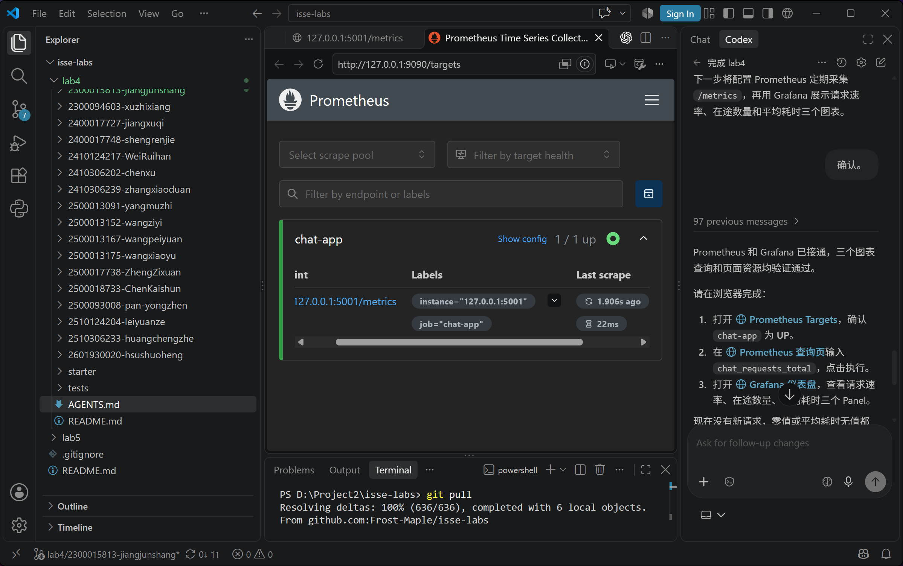
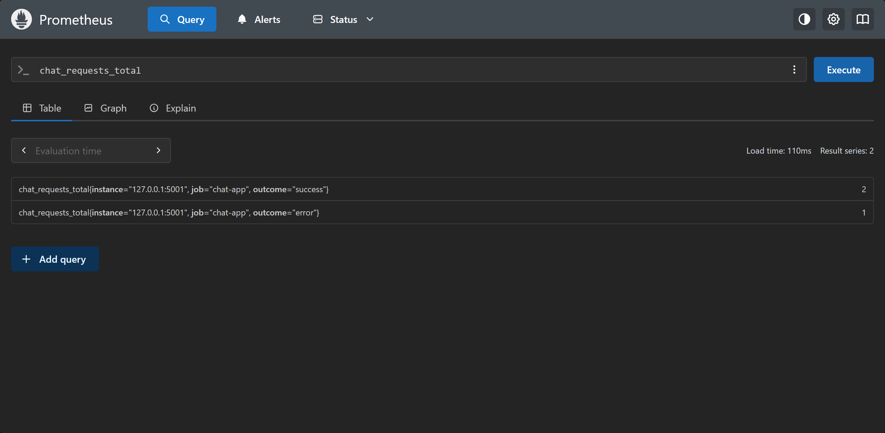
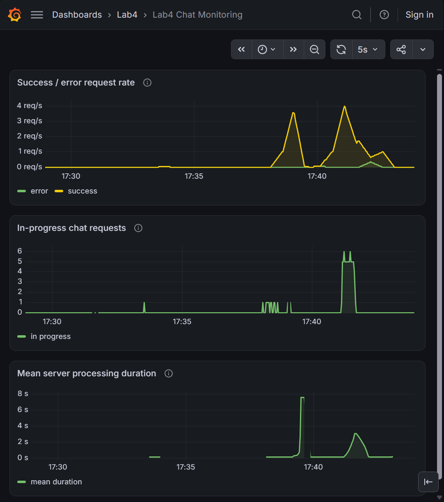

# Lab4：姜珺尚 2300015813

基于本人 Lab3 的 Flask 多会话聊天应用，保留前端、会话和消息 CRUD，以及真实模型调用功能。本实验默认使用本地 mock 回复，不需要 Key，不读取 `.env`。

## Windows PowerShell 运行

在本目录执行：

```powershell
python -m venv .venv
./.venv/Scripts/python.exe -m pip install --index-url https://pypi.org/simple -r requirements.txt
./start-app.ps1
```

浏览器打开 `http://127.0.0.1:5001/`，新建会话后发送测试消息。应用使用单进程、多线程，监听本机 5001 端口。启动脚本显式设置 `CHAT_MODE=mock`。聊天数据存于 `.runtime/app/conversations.json`，不提交到 Git。

`CHAT_MODE` 只接受 `mock` 和 `real`，默认 `mock`。`real` 保留原 DeepSeek 请求流程，只在调用时从后端环境变量读取 `DEEPSEEK_API_KEY`；本实验不运行 real 模式。mock 不调用外部模型，前端显示当前模式。

## 接口与指标

原聊天接口仍为 `POST /api/conversations/<id>/messages`，JSON 中 `message` 为非空字符串。mock 模式可额外传入 `mock_delay_seconds`（0–30 秒有限数，默认 0.1）及 `mock_force_error`（布尔值，默认 false）。延迟发生在后端，强制失败返回 HTTP 503 和 `simulated: true`；成功保存记录并返回 HTTP 201。real 模式忽略这两个测试选项。

`GET /api/lab/status` 仅在 mock 模式返回当前模式及 `external_model_calls: false`，real 模式返回 404。`GET /api/hello` 返回连通性信息及当前模式。

`http://127.0.0.1:5001/metrics` 使用 `prometheus_client` 标准文本格式提供：

| 指标 | 含义 |
| --- | --- |
| `chat_requests_total{outcome="success"或"error"}` | 按最终处理结果累计聊天请求数，两个标签初始化为零 |
| `chat_inprogress_requests` | 当前正在处理的聊天请求数量 |
| `chat_request_duration_seconds` | 服务端处理耗时 Histogram，包含成功和失败 |

耗时桶边界为 0.05、0.1、0.25、0.5、1、2、3、5、10、20、30 秒及正无穷。指标装饰器覆盖原聊天 POST 处理，包括输入验证、模型回复和存储；异常时仍更新错误数、耗时并减少在途数量。创建会话、修改/删除记录、静态资源、状态和采集请求不计入聊天指标。指标不包含消息内容或请求 ID 标签，进程重启后重新计数。

数据锁只在读取和保存记录时持有，模拟等待不占有锁。原会话并发变更检查保留：如果生成回复期间会话被修改或删除，则返回 409，避免覆盖已有数据。

## 已核验的应用行为

本机使用 Python 3.14.6、Flask 3.1.3、prometheus-client 0.26.0、requests 2.34.2。Flask 测试客户端检查通过：mock 路径不调用真实模型函数，成功和模拟失败按结果累计；非法延迟和失败参数返回 400；未捕获异常仍完成指标收尾；页面、静态资源、状态、采集及 CRUD 不增加聊天请求数。real 分支仅用替身函数检查模式分流与测试参数隔离，未调用真实模型。

实际本地 HTTP 检查中，一个 2 秒慢聊天请求在处理中时，`/metrics` 约 0.018 秒返回且显示在途数为 1。请求成功后，再发送一次模拟失败请求，最终成功和错误各累计 1 次，耗时样本数为 2，在途数量回到 0。测试会话已删除，指标保留至进程重启。此检查不是课程完整五阶段模拟。

## 本地文件

`.venv/` 为 Python 虚拟环境，`.tools/` 存放监控工具，`.runtime/` 存放运行数据和日志，均由个人 `.gitignore` 忽略。课程 `simulate_traffic.py`、`project_adapter.py`、`prometheus.yml` 已复制到个人目录。

## Prometheus 与 Grafana

本实验使用官方稳定版 Windows x64 程序：Prometheus 3.15.0、Grafana OSS 13.2.4。下载来源分别为 [Prometheus 官方下载页](https://prometheus.io/download/) 和 [Grafana OSS 官方下载页](https://grafana.com/grafana/download?edition=oss&platform=windows)。本机 Windows 系统为 ARM64，Python 进程为 AMD64，选择可在本机运行的 Windows x64 程序。

在个人目录中安装并启动监控：

```powershell
./.venv/Scripts/python.exe ./install-tools.py
./start-monitoring.ps1
```

安装脚本固定官方版本、下载地址和 SHA256；只在完整校验通过后解压，拒绝覆盖已存在的工具目录。若只需补装某一项，使用 `--only prometheus` 或 `--only grafana`。Grafana 使用八路有界 HTTP 字节范围下载，每段验证范围和长度，再合并并校验完整安装包；使用 Windows 自带 `tar.exe` 解压，跳过不参与运行的 `docs/`、`packaging/` 附带目录，以及 TypeScript、SCSS、源码映射、测试快照等开发文件。保留运行所需的程序、配置、JavaScript、CSS、HTML、JSON、字体和图片。安装包、分段及校验记录均位于 `.tools/downloads/`，程序分别解压到 `.tools/prometheus/`、`.tools/grafana/`。

启动脚本显式传入以下命令参数，并通过环境变量配置 Grafana 的运行路径：

```powershell
# start-monitoring.ps1 内执行的等价命令，路径相对于个人目录
./.tools/prometheus/prometheus.exe --config.file=prometheus.yml --storage.tsdb.path=.runtime/prometheus --web.listen-address=127.0.0.1:9090

$env:GF_PATHS_DATA = "$PWD/.runtime/grafana/data"
$env:GF_PATHS_LOGS = "$PWD/.runtime/grafana/logs"
$env:GF_PATHS_PLUGINS = "$PWD/.runtime/grafana/plugins"
$env:GF_PATHS_PROVISIONING = "$PWD/provisioning"
$env:LAB4_DASHBOARD_DIR = "$PWD/.runtime/grafana/dashboards"
# 启动脚本会先创建运行目录，并将根目录的仪表盘 JSON 复制到 dashboards 目录
./.tools/grafana/bin/grafana.exe server --homepath="$PWD/.tools/grafana" --config="$PWD/grafana.ini"
```

Prometheus 数据位于 `.runtime/prometheus/`；Grafana 数据库、日志、插件及仪表盘运行副本均位于 `.runtime/grafana/` 子目录。配置文件保留在个人目录，可随项目提交。启动脚本记录进程 ID，并在再次执行时复用已记录且程序路径一致的进程；其他进程占用端口时会报错，不关闭其他服务。

Prometheus 页面为 `http://127.0.0.1:9090/targets`，采集 `http://127.0.0.1:5001/metrics`，job 名为 `chat-app`，间隔 2 秒、超时 1 秒。可在查询页面执行 `chat_requests_total{job="chat-app"}` 查看累计值。Target 的 `UP` 仅表示指标采集成功。

Grafana 仪表盘为 `http://127.0.0.1:3000/d/lab4-chat/lab4-chat-monitoring`，仅监听本机，允许匿名 Viewer 查看。数据源通过 `provisioning/datasources/prometheus.yml` 配置，固定 UID 为 `lab4-prometheus`，URL 为 `http://127.0.0.1:9090`，不是应用地址。仪表盘通过 `provisioning/dashboards/lab4.yml` 加载，默认查看最近 15 分钟、每 5 秒刷新。

三个 Panel 的 PromQL：

```promql
sum by (outcome) (rate(chat_requests_total{job="chat-app"}[30s]))

sum(chat_inprogress_requests{job="chat-app"})

sum(rate(chat_request_duration_seconds_sum{job="chat-app"}[30s]))
/
sum(rate(chat_request_duration_seconds_count{job="chat-app"}[30s]))
```

第一个查询分别显示 success/error 最近 30 秒的平均每秒完成请求数，不是累计值。第二个显示当前在途量，不是在线用户数。第三个用最近窗口内耗时增加速率除以样本数增加速率，得到服务端平均秒数；没有请求时可能无值，不补造零值。

`grafana-dashboard.json` 中的 Panel 绑定 `lab4-prometheus` 数据源 UID。干净环境使用启动脚本即可自动创建对应数据源并加载；在已有 Grafana 中导入时，应先创建相同 UID 的 Prometheus 数据源，或将各 Panel 的数据源改选为已有 Prometheus。Histogram 的 `_bucket{le="..."}` 是不超过该边界的累计样本数，`_sum` 是总秒数，`_count` 是样本数；本次均值查询使用后两者。

本地连接核验：Prometheus Target 的 job 为 `chat-app`，采集 URL 为 `http://127.0.0.1:5001/metrics`，状态为 `up`，没有采集错误；可查询成功和失败累计次数。Grafana 健康接口返回 HTTP 200、数据库 `ok`、版本 13.2.4；仪表盘包含三个 Panel。通过 Grafana 数据源查询接口执行 `up{job="chat-app"}` 得到 1，三个 Panel 的实际范围查询均返回 HTTP 200 且无查询错误。仪表盘 HTML 及其引用的七个 JavaScript/CSS 资源均返回 HTTP 200。无新请求时，速率和在途量为 0，平均耗时无值；连接检查不等于完整访问模拟。

学生浏览器原始截图：Targets 显示 `chat-app` 为 `1/1 up`、地址为 `127.0.0.1:5001/metrics`；查询显示 success 为 2、error 为 1。





## 访问脚本适配

`simulate_traffic.py` 与课程调度器一致，发送节奏、并发限制、本地地址检查、禁用重定向和结果统计均保留。个人 `project_adapter.py` 的三个适配函数已完成真实 HTTP 单请求验证，`ADAPTER_READY=True`：

- `confirm_mock_mode()` 请求 `/api/lab/status`，只有响应明确为 mock 且 `external_model_calls` 为 false 才通过；禁用代理和重定向，并在适配器自身请求前验证本地根地址。
- `build_chat_request()` 为每个并发线程通过原 `/api/conversations` 接口创建独立测试会话，并在线程内顺序复用，再构造 `POST /api/conversations/<id>/messages` 请求，传入 `message`、`mock_delay_seconds`、`mock_force_error`。线程之间隔离会话，避免原项目的同会话并发变更冲突；复用减少额外创建和磁盘写入。创建会话超时为 10 秒。模拟产生的会话只保存在被忽略的本地运行数据中，不清理用户自己的会话。
- `response_is_success()` 同时检查 HTTP 201、有效记录 ID、非空问题与回复，以及响应中没有 error；错误及无效 JSON 均判为失败，不打印聊天正文。

验证中，正常聊天返回 201，强制失败返回 503 且 `simulated=true`；测试会话随后删除。两个并发线程的测试进一步确认：线程内顺序复用同一会话，线程之间使用不同会话，成功与模拟失败均能识别。对临时本地 real 配置服务的 HTTP 核验返回不通过，调度器在发送聊天前退出，未调用外部模型。验证和未完成运行产生的真实请求也进入指标；正式结果以结果 JSON 中的完整阶段时间范围为准。

线程首次创建测试会话的操作不计入聊天指标。调度器的客户端计时从构造聊天请求后开始，因此不包含创建会话的准备时间；发送调度的并发占用仍包含这段准备时间。后续比较图表时，以服务端 Histogram 作为服务端耗时依据。

## 首次完整模拟

在个人目录运行：

```powershell
./.venv/Scripts/python.exe -u ./simulate_traffic.py --base-url http://127.0.0.1:5001 --output results/first-run.json
```

真实结果见 `results/first-run.json`，运行未中断，退出码为 0。五个阶段均使用默认参数：每阶段发送 30 秒、并发上限 6、聊天超时 10 秒，最后等待采集 10 秒。时间为 2026-10-18 北京时间（JSON 记录 UTC）：

| 阶段 | 实际时间 | 发送 | 成功 | 业务/HTTP 错误 | 并发满跳过 | 客户端平均秒数 |
| --- | --- | ---: | ---: | ---: | ---: | ---: |
| baseline：1 次/秒，延迟 0.1 秒 | 17:40:05–17:40:35 | 30 | 30 | 0 | 0 | 0.184 |
| burst：4 次/秒，延迟 0.1 秒 | 17:40:35–17:41:05 | 120 | 120 | 0 | 0 | 0.188 |
| slow：2 次/秒，延迟 3 秒 | 17:41:05–17:41:38 | 52 | 52 | 0 | 8 | 3.091 |
| errors：1 次/秒，每第 3 次失败 | 17:41:38–17:42:08 | 30 | 20 | 10 | 0 | 0.189 |
| recovery：1 次/秒，延迟 0.1 秒 | 17:42:08–17:42:38 | 30 | 30 | 0 | 0 | 0.203 |

共发送 262 次，成功 252 次，预期模拟失败 10 次；网络错误与非预期结果均为 0。慢阶段的实际结束时间包含在途请求收尾，因此超过 30 秒。并发满时跳过发送机会，不无限排队，目标速率不等于完成速率。

对完整运行时间范围实际查询 Prometheus（2 秒步长），成功请求速率最大值为 4 次/秒，错误请求速率最大值约为 0.357 次/秒，在途量最大值为 6，服务端平均耗时最大值约为 3.036 秒。该均值来自 Histogram 的 `_sum`/`_count`，不同于表中含网络开销的客户端耗时。30 秒窗口会平滑阶段边界，并使恢复后的速率回落有滞后。

首次运行查看范围：2026-10-18 17:40:05–17:43:13，包含末尾恢复观测。[打开本地仪表盘固定范围](http://127.0.0.1:3000/d/lab4-chat/lab4-chat-monitoring?from=1792316405000&to=1792316593000)。该范围避开未完成的先前尝试；原始累计 Counter 包含所有真实测试请求。

学生原始仪表盘截图包含三个 Panel 及图例，时间轴覆盖完整五阶段，也包含之前未完成尝试。应以 17:40:05–17:42:38 对照本次结果；更早的峰值不属于这次完整模拟。图片按原始 PNG 保存，未裁剪或修改。



## 调整并发上限后的模拟

只修改并发上限，由 6 改为 3；单独重跑 slow 场景，其余请求参数仍为默认值：目标每秒 2 次、后端延迟 3 秒、持续发送 30 秒。

```powershell
./.venv/Scripts/python.exe -u ./simulate_traffic.py --base-url http://127.0.0.1:5001 --scenario slow --concurrency 3 --output results/changed-run.json
```

真实结果见 `results/changed-run.json`，北京时间为 2026-10-18 17:57:22–17:57:54，之后等待采集 10 秒。运行未中断，退出码为 0。共计划 60 次发送机会，实际发送 27 次且全部成功，跳过 33 次；业务/HTTP 错误、网络错误和非预期结果均为 0。客户端平均耗时约 3.091 秒。

| 比较项 | 首次 slow：并发 6 | 第二次 slow：并发 3 |
| --- | ---: | ---: |
| 实际成功请求数 | 52 | 27 |
| 并发满跳过的发送机会 | 8 | 33 |
| Prometheus 采集到的在途峰值 | 6 | 3 |
| slow 阶段范围内的服务端平均耗时曲线最大值 | 约 3.04 秒 | 约 3.05 秒 |

降低脚本并发上限后，实际在途峰值由 6 降为 3；平均耗时仍在 3 秒附近，实际发送减少、跳过增加。在途指标统计应用收到的所有聊天请求；这里的并发上限只约束模拟脚本，并非 Flask 的全局限流。比较时没有其他聊天访问。

[第二次运行的固定仪表盘范围](http://127.0.0.1:3000/d/lab4-chat/lab4-chat-monitoring?from=1792317432000&to=1792317509000) 为 17:57:12–17:58:29，包含发送前及恢复后的观测。学生在浏览器观察到峰值为 3。`grafana-dashboard.json` 已从实际 Grafana 仪表盘接口导出，保留三个 Panel、查询和固定数据源 UID，仅移除当前安装分配的数字 ID，便于重新导入。
